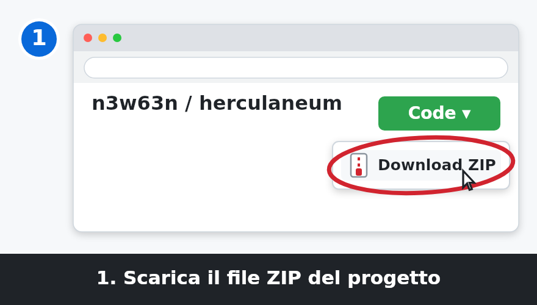
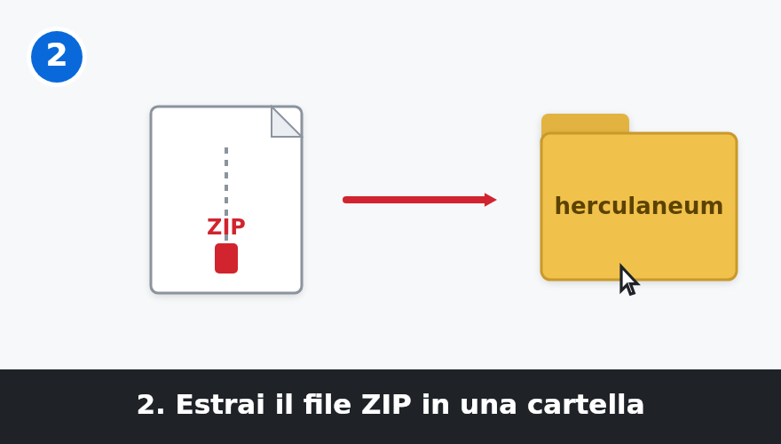
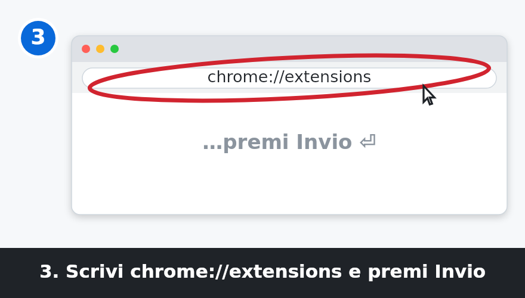
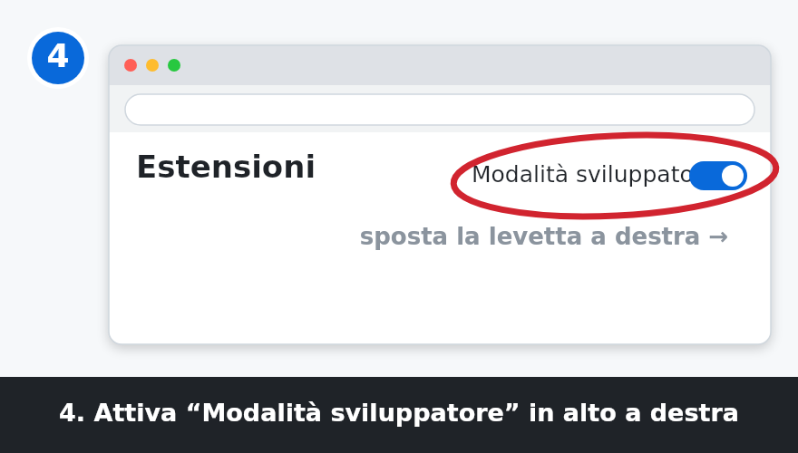
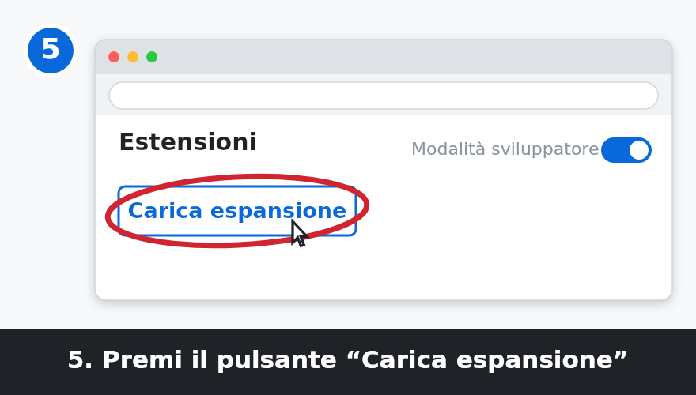
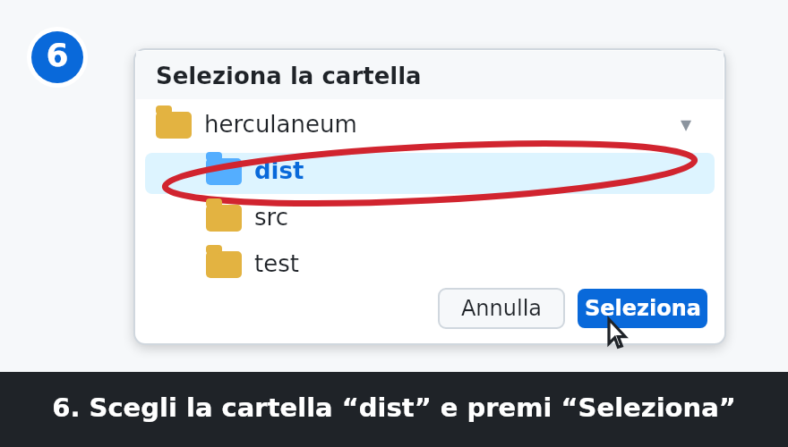
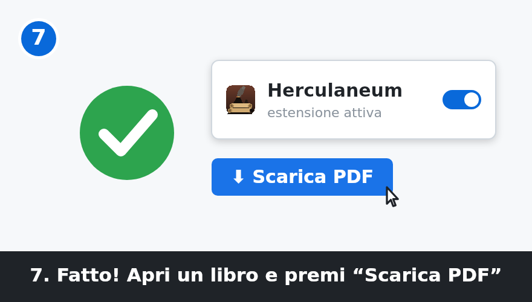

# Come installare Herculaneum

Segui questi 7 passaggi. Sono facili. Non serve saper programmare.

**Serve:** il browser Google Chrome (su computer) e il file ZIP di questo progetto.

---

## Passaggio 1 — Scarica il file ZIP

Apri questa pagina con Chrome. Premi il pulsante verde **Code**, poi premi **Download ZIP**.



## Passaggio 2 — Estrai il file ZIP

Vai nella cartella **Download**. Fai **clic destro** sul file ZIP. Scegli **Estrai tutto** (oppure **Extract all**). Il contenuto va in una cartella nuova, chiamata `herculaneum`.



## Passaggio 3 — Apri la pagina delle estensioni

Clicca nella barra in alto di Chrome. Scrivi questo indirizzo e premi il tasto **Invio**:

```
chrome://extensions
```



## Passaggio 4 — Attiva la modalità sviluppatore

In alto a destra c'è la scritta **Modalità sviluppatore**. Sposta la levetta accanto a destra, così diventa blu.

> Nota: se Chrome ti mostra un avviso, premi **Ok** o **Ignora**. Non è un errore.



## Passaggio 5 — Premi "Carica espansione"

In alto a sinistra compare il pulsante blu **Carica espansione**. Premilo.



## Passaggio 6 — Scegli la cartella "dist"

Si apre una finestra per scegliere una cartella.

1. Entra nella cartella `herculaneum`.
2. Entra nella cartella **`dist`** (fai doppio clic su `dist`).
3. Premi **Seleziona**.

⚠️ Scegli la cartella **`dist`**, non quella principale. Se scegli quella sbagliata, Chrome mostra un errore: rifai il passaggio 6.



## Passaggio 7 — Fatto!

La estensione **Herculaneum** compare nella lista, con la levetta blu.

Ora puoi usarla:

1. Apri un libro su HubScuola.
2. Sfoglia qualche pagina.
3. In basso a destra premi il pulsante blu **⬇ Scarica PDF**.
4. Aspetta. Il PDF finisce nella cartella **Download**.



---

## Se qualcosa non funziona

| Problema | Cosa fare |
|---|---|
| Chrome dice che la cartella non è valida | Ripeti il passaggio 6 e scegli la cartella `dist` dentro `herculaneum`. |
| Il pulsante "Scarica PDF" non compare | Chiudi e riapri la pagina del libro. Se non basta, vai su `chrome://extensions` e premi l'icona **⟳** sotto Herculaneum. |
| Dice "Sessione non trovata" | Nel libro, sfoglia qualche pagina e riprova. |
| Chrome mostra un avviso giallo sulle estensioni | È normale con questa modalità. Premi **Ignora** o chiudi l'avviso. |
| L'estensione è sparita | Riallacciala: `chrome://extensions` → **Carica espansione** → cartella `herculaneum/dist`. |

---

## Disinstallare

Vai su `chrome://extensions`, trova **Herculaneum** e premi **Rimuovi**.

---

## Per chi sviluppa

Per ricreare `dist/` dopo aver modificato il codice:

```sh
npm install
npm run build   # genera dist/
npm test        # esegue i test
```

Per rigenerare le immagini di questa guida:

```sh
node tools/make-install-images.mjs
```
